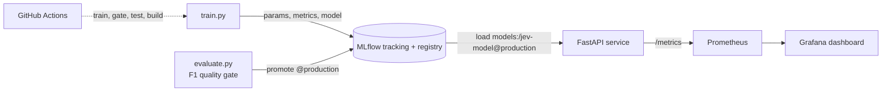

# JEV MLOps Pipeline


An end-to-end MLOps demo: train a scikit-learn model, track experiments, gate promotion on quality, serve it over an API, and monitor it in production. Everything runs locally with Docker Compose and is tested in CI.

> The model trains on a synthetic dataset as a placeholder. Swap `load_data()` in `src/train.py` to use real data.

## Architecture



## What it demonstrates

- **Experiment tracking:** every training run logs parameters, F1 and the model to MLflow.
- **Model registry with a quality gate:** `evaluate.py` fails the pipeline if F1 is below 0.80, and only then sets the `production` alias.
- **Serving:** a FastAPI app loads whichever version holds `@production`, so promoting a model needs no code change.
- **Observability:** Prometheus scrapes request rate, latency and errors, plus a custom `jev_predictions_total` counter. A Grafana dashboard is provisioned as code.
- **CI:** GitHub Actions trains a model, runs the quality gate, runs pytest, and builds the Docker image.

## Quick start

Requires Docker and Python 3.10+.

```bash
python3 -m venv .venv && source .venv/bin/activate
pip install -r requirements.txt

# 1. start the MLflow server
docker compose up -d --build mlflow

# 2. train candidates and promote the best passing model
export MLFLOW_TRACKING_URI=http://localhost:5000
python src/train.py --n-estimators 50 --max-depth 3
python src/train.py --n-estimators 300
python src/evaluate.py

# 3. start the API and monitoring
docker compose up -d --build api prometheus grafana
```

| Service    | URL                          |
|------------|------------------------------|
| MLflow     | http://localhost:5000        |
| API docs   | http://localhost:8000/docs   |
| Prometheus | http://localhost:9095        |
| Grafana    | http://localhost:3001 (admin / admin) |

Try it:

```bash
curl -X POST localhost:8000/predict -H "Content-Type: application/json" \
  -d '{"f0":0.1,"f1":-0.5,"f2":1.2,"f3":0.3,"f4":-1.0,"f5":0.7,"f6":0.0,"f7":0.9}'
```

## Project layout

```
src/            train.py, evaluate.py, serve.py
tests/          pytest suite (data checks, API contract)
monitoring/     Prometheus config and provisioned Grafana dashboard
.github/        CI workflow
```

## Drift detection and automated retraining

`monitoring/retrain_if_drift.sh` closes the loop:

1. `drift_check.py` compares training data with a production batch using Evidently and exits non-zero when 30% or more of the columns drift.
2. On drift, `train.py` retrains on the new data and registers a candidate.
3. `evaluate.py` scores the candidate **and** the current `@production` model on the same test set. It promotes the candidate only if it clears the 0.80 gate **and** beats production.

Result from the simulated drift (four of eight features shifted):

| Model | F1 on shifted data |
|---|---|
| Old production model | 0.838 |
| Retrained candidate | 0.915 (promoted) |

The drift is simulated by shifting feature means and variance, so these numbers demonstrate the mechanism, not real-world performance. In a real deployment, `make_batch` would read logged production requests instead.

A scheduled GitHub Actions workflow (`drift-retrain.yml`) runs the same loop weekly and can be triggered manually.

## Roadmap

- [x] Data drift detection with Evidently
- [x] Automated retraining that promotes a model only if it beats production
- [ ] Prometheus alert rules
- [ ] Real production-traffic logging instead of simulated batches

## Screenshots

_Add: MLflow run comparison, model registry, Grafana dashboard._
